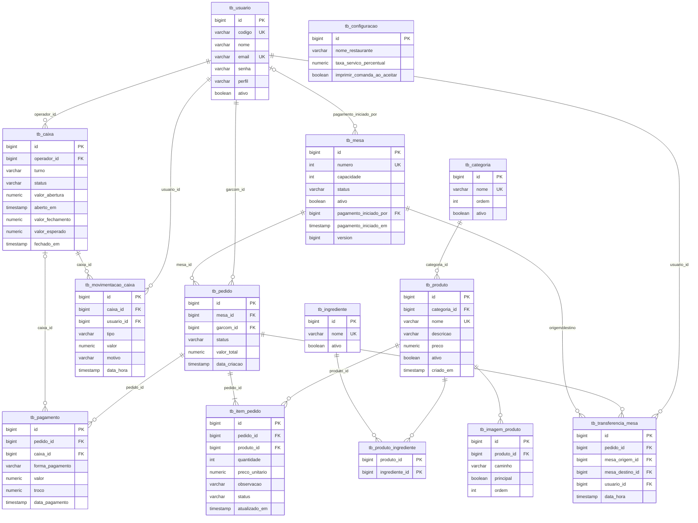

# Banco de dados do RestManager

Responsável: Lucas Ormenese Altieri · PostgreSQL 16 (ADR 0001)

## Como o banco é criado

O banco roda no Docker (serviço `db` do `compose.yaml`). Na **primeira** subida, com o volume vazio, o Postgres executa:

| Arquivo | O que faz |
| :--- | :--- |
| `docker/db/init/01-schema.sql` | Cria as 14 tabelas, chaves, índices e regras (CHECK/UNIQUE) |
| `docker/db/init/02-seed.sql` | Insere usuários de teste, 10 mesas, cardápio, configuração e 1 pedido de exemplo |

O Hibernate **não** cria tabelas (`ddl-auto: validate`). Ele só confere, ao subir, se as entidades batem com o banco. Se você criar uma entidade nova, a tabela precisa estar no `01-schema.sql`.

## Primeiros passos (uma vez)

```powershell
# os dois repositórios precisam estar na mesma pasta
git clone https://github.com/Bia-z/pi4-0102-08-backend.git
git clone https://github.com/Bia-z/pi4-0102-08-frontend.git
cd pi4-0102-08-backend
Copy-Item .env.example .env      # Linux/Mac: cp .env.example .env
docker compose up -d db          # só o banco
```

Para rodar o backend:
- **IntelliJ:** rode `RestManagerApplication` normalmente (conecta em `localhost:5432`).
- **Tudo no Docker:** `docker compose up --build`.

## Variáveis (`.env`)

| Variável | Valor de desenvolvimento | Para que serve |
| :--- | :--- | :--- |
| `POSTGRES_DB` | `restmanager` | Nome do banco |
| `POSTGRES_USER` | `restmanager` | Usuário do banco |
| `POSTGRES_PASSWORD` | `restmanager` | Senha do banco |
| `JWT_SECRET` | `segredo-de-desenvolvimento-com-mais-de-32-caracteres` | Assina os tokens de login (mínimo de 32 caracteres) |

Use exatamente esses valores: são os mesmos padrões do `application.yml`, então o backend funciona igual no Docker e no IntelliJ. O compose repassa as variáveis ao backend como `SPRING_DATASOURCE_URL`, `SPRING_DATASOURCE_USERNAME`, `SPRING_DATASOURCE_PASSWORD` e `JWT_SECRET`.

## Usuários de teste

Senha de todos: **`restmanager123`**

| Código | Perfil |
| :--- | :--- |
| `admin` | ADMIN |
| `garcom1`, `garcom2` | GARCOM |
| `cozinha` | COZINHA |
| `caixa` | CAIXA |
| `inativo` | GARCOM inativo (o login deve dar 403) |

```powershell
Invoke-RestMethod -Method Post -Uri http://localhost:8080/api/auth/login `
  -ContentType 'application/json' -Body '{"codigo":"admin","senha":"restmanager123"}'
```

## Comandos úteis

```powershell
docker compose exec db psql -U restmanager -d restmanager   # abrir o console SQL
docker compose down -v; docker compose up -d db               # RECRIAR o banco (apaga os dados)
```

> Mudou o `01-schema.sql` ou o `02-seed.sql`? Rode `docker compose down -v` antes de subir. Sem isso, os scripts não executam de novo.

> O cadastro CT1 adiciona `cpf` e `telefone`, torna `email` opcional e exige CPF único em `tb_usuario`. Para um banco já existente, aplique uma migração equivalente antes de iniciar o backend: `ALTER TABLE tb_usuario ALTER COLUMN email DROP NOT NULL; ALTER TABLE tb_usuario ADD COLUMN cpf VARCHAR(14), ADD COLUMN telefone VARCHAR(20); ALTER TABLE tb_usuario ADD CONSTRAINT uk_usuario_cpf UNIQUE (cpf);`. A migração pode falhar se já existirem CPFs repetidos; corrija os registros duplicados antes de criar a restrição. Não é necessário apagar o volume.

## Convenções

- Tabelas `tb_*` e colunas em `snake_case`; IDs `BIGINT` identity (`Long` + `GenerationType.IDENTITY`).
- **Enums em MAIÚSCULAS** (`GARCOM`, `EM_PAGAMENTO`, `PIX`...), iguais aos enums Java com `@Enumerated(EnumType.STRING)`.
- Dinheiro em `NUMERIC(10,2)` (`BigDecimal`); datas em `TIMESTAMP` (`LocalDateTime`).

## Modelo entidade-relacionamento



## Valores permitidos (CHECK)

| Coluna | Valores |
| :--- | :--- |
| `tb_usuario.perfil` | ADMIN, GARCOM, COZINHA, CAIXA |
| `tb_mesa.status` | DISPONIVEL, OCUPADA, RESERVADA, EM_PAGAMENTO |
| `tb_pedido.status` | AGUARDANDO, EM_PREPARO, PRONTO, PAGO, CANCELADO |
| `tb_item_pedido.status` | AGUARDANDO, EM_PREPARO, PRONTO, CANCELADO |
| `tb_pagamento.forma_pagamento` | DINHEIRO, CREDITO, DEBITO, PIX, VALE |
| `tb_caixa.status` | ABERTO, FECHADO (só um caixa ABERTO por vez) |
| `tb_movimentacao_caixa.tipo` | SANGRIA, REFORCO |

## Operações de caixa e impressão

- `POST /api/caixa/abrir`, `GET /api/caixa/aberto` e `POST /api/caixa/fechar` controlam o turno. O fechamento compara o dinheiro contado com a abertura, pagamentos em dinheiro líquidos de troco e movimentações.
- `POST /api/caixa/movimentacoes` registra sangria ou reforço; `GET /api/caixa/historico` lista fechamentos.
- `GET /api/caixa/relatorios/{AAAA-MM-DD}` retorna os totais por forma de pagamento e movimentações do dia; o sufixo `/pdf` gera o arquivo PDF.
- `GET /api/caixa/configuracao` consulta as opções e `PUT` atualiza nome, taxa de serviço (0 a 100%) e impressão automática.
- `GET /api/pedidos/{pedidoId}/comanda` retorna os itens imprimíveis e `/pdf` gera a comanda. Quando a impressão automática está habilitada, a cozinha recebe a comanda em `/topic/comandas` ao iniciar o preparo.

O schema ainda não mantém histórico de impressões/reimpressões da comanda; o endpoint gera a comanda a partir do pedido existente. Os turnos aceitos pelo backend são `MANHA`, `TARDE` e `NOITE`.

## Pendências (a combinar)

| Item | Com quem |
| :--- | :--- |
| Confirmar o status por item + status geral do pedido | Heitor (E3) e Vitória (E5) |
| Tabelas de cancelamento (E12), reserva (E13) e histórico de impressão da comanda (E15) | Vitória |
| Definição formal de turnos para o caixa (E10/E11) | Nathalia |
