# 1. Visão geral
**Responsável:** Beatriz Caroline Moreno Tavares

**Problema.** Restaurantes de pequeno e médio porte controlam pedidos, mesas e caixa
com comandas de papel, planilhas e comunicação verbal entre garçom e cozinha. Isso
causa pedidos trocados ou esquecidos, atraso no atendimento e divergência na
conferência do caixa. O gestor não enxerga o salão em tempo real, e os sistemas de PDV
do mercado são caros e trazem módulos (fiscal, estoque, reservas) que um restaurante
pequeno não usa.

**Público**
- Garçom: lança pedidos nas mesas e acompanha o andamento na cozinha.
- Cozinha: vê os pedidos por ordem de chegada, muda o status e imprime a comanda.
- Caixa: abre e fecha o turno (com senha), controla as mesas, recebe o pagamento
  (inclusive dividido), faz sangria/reforço e consulta ou cancela comandas.
- Administrador: cadastra funcionários, mesas, categorias e cardápio.
- O cliente do restaurante não usa o sistema.

**Escopo**
- E1 Cadastro e autenticação de usuários, com acesso só à área do próprio perfil.
- E2 Cadastro de mesas e do cardápio (produtos e categorias).
- E3 Lançamento de pedido pelo garçom, com observação por item.
- E4 Painel da cozinha atualizado em tempo real, sem recarregar a página.
- E5 Mudança de status do pedido pela cozinha, refletida no garçom.
- E6 Controle de mesas, abertura e fechamento de turno do caixa.
- E7 Pagamento dividido em mais de uma forma, com cálculo de troco.
- E8 Comprovante de pagamento em PDF.
- E9 Transferência de pedido entre mesas.
- E10 Sangria e reforço de caixa, com comanda impressa de valor, horário, tipo e motivo.
- E11 Relatórios do dia e histórico de fechamentos de turno, com reimpressão.
- E12 Cancelamento de pedido já pago, com login e senha de administrador.

**Fora do escopo.** Aplicativo móvel nativo (o sistema é um site responsivo), pedido
feito pelo próprio cliente, reservas e fila de espera, emissão fiscal (NFC-e/SAT),
integração com maquininhas, controle de estoque e o cadastro de ingredientes por prato,
que estava nos wireframes e foi cortado.

# 2. Objetivos
**Responsável:** Beatriz Caroline Moreno Tavares

**Objetivo geral.** Construir uma plataforma web de gestão de restaurante que substitua
as comandas de papel e integre pedidos, cozinha, mesas e caixa em um fluxo único e em
tempo real.

**Objetivos específicos**
- OE1: Digitalizar o lançamento de pedidos pelo garçom, eliminando a comanda de papel.
- OE2: Mostrar o pedido à cozinha em tempo real, por ordem de chegada, e refletir a
  mudança de status no garçom.
- OE3: Integrar o fechamento da conta ao caixa, com controle de mesas, pagamento
  dividido e turno protegido por senha.
- OE4: Restringir cada funcionalidade ao perfil do usuário.
- OE5: Subir o sistema inteiro com um comando, em qualquer máquina com Docker.

**Critério de sucesso.** O garçom lança um pedido, a cozinha o recebe e muda o status, e
o garçom vê a mudança em menos de 2 segundos sem recarregar; o caixa fecha a conta
(dividida em mais de uma forma) e o turno, com senha, sem uso de papel; e o sistema sobe
com `docker compose up -d --build`.

# 3. REQUISITOS

# 4. ARQUITETURA

# 5. BANCO DE DADOS

# 6. CONTRATOS E DECISÕES
Responsável: Vitória Aparecida Brigo Mattos

### 6.1 Contratos

| ID | Nome | Fronteira | Onde está |
| :--- | :--- | :--- | :--- |
| CT1 | cadastrarUsuario | HTTP | [backend/docs/contrato/CT1-cadastrarUsuario.md](contrato/CT1-cadastrarUsuario.md) |
| CT2 | tb_usuario | Banco | [backend/docs/contrato/CT2-tb_usuario.md](contrato/CT2-tb_usuario.md) |
| CT3 | autenticarUsuario | HTTP | [backend/docs/contrato/CT3-autenticarUsuario.md](contrato/CT3-autenticarUsuario.md) |
| CT4 | cadastrarProduto | HTTP | [backend/docs/contrato/CT4-cadastrarProduto.md](contrato/CT4-cadastrarProduto.md) |
| CT5 | cadastrarMesa | HTTP | [backend/docs/contrato/CT5-cadastrarMesa.md](contrato/CT5-cadastrarMesa.md) |
| CT6 | tb_mesa | Banco | [backend/docs/contrato/CT6-tb_mesa.md](contrato/CT6-tb_mesa.md) |
| CT7 | criarPedido | HTTP | [backend/docs/contrato/CT7-criarPedido.md](contrato/CT7-criarPedido.md) |
| CT8 | tb_pedido | Banco | [backend/docs/contrato/CT8-tb_pedido.md](contrato/CT8-tb_pedido.md) |
| CT9 | pedidoCriado | WebSocket (STOMP) | [backend/docs/contrato/CT9-pedidoCriado.md](contrato/CT9-pedidoCriado.md) |
| CT10 | atualizarStatusPedido | HTTP | [backend/docs/contrato/CT10-atualizarStatusPedido.md](contrato/CT10-atualizarStatusPedido.md) |
| CT11 | statusPedidoAtualizado | WebSocket (STOMP) | [backend/docs/contrato/CT11-statusPedidoAtualizado.md](contrato/CT11-statusPedidoAtualizado.md) |
| CT12 | obterMapaMesas | HTTP | [backend/docs/contrato/CT12-obterMapaMesas.md](contrato/CT12-obterMapaMesas.md) |
| CT13 | tb_pedido_extrato | Banco | [backend/docs/contrato/CT13-tb_pedido_extrato.md](contrato/CT13-tb_pedido_extrato.md) |
| CT14 | processarPagamento | HTTP | [backend/docs/contrato/CT14-processarPagamento.md](contrato/CT14-processarPagamento.md) |
| CT15 | tb_pagamento | Banco | [backend/docs/contrato/CT15-tb_pagamento.md](contrato/CT15-tb_pagamento.md) |
| CT16 | gerarComprovantePDF | HTTP | [backend/docs/contrato/CT16-gerarComprovantePDF.md](contrato/CT16-gerarComprovantePDF.md) |
| CT17 | tb_extrato_completo | Banco | [backend/docs/contrato/CT17-tb_extrato_completo.md](contrato/CT17-tb_extrato_completo.md) |
| CT18 | transferirMesa | HTTP | [backend/docs/contrato/CT18-transferirMesa.md](contrato/CT18-transferirMesa.md) |
| CT19 | iniciarPagamento | HTTP | [backend/docs/contrato/CT19-iniciarPagamento.md](contrato/CT19-iniciarPagamento.md) |
| CT20 | cancelarPagamento | HTTP | [backend/docs/contrato/CT20-cancelarPagamento.md](contrato/CT20-cancelarPagamento.md) |
| CT21 | statusMesaAtualizado | WebSocket (STOMP) | [backend/docs/contrato/CT21-statusMesaAtualizado.md](contrato/CT21-statusMesaAtualizado.md) |
| CT22 | listarPedidos | HTTP | [backend/docs/contrato/CT22-listarPedidos.md](contrato/CT22-listarPedidos.md) |
| CT23 | cancelarItemPedido | HTTP | [backend/docs/contrato/CT23-cancelarItemPedido.md](contrato/CT23-cancelarItemPedido.md) |
| CT24 | gerenciarMesas | HTTP | [backend/docs/contrato/CT24-gerenciarMesas.md](contrato/CT24-gerenciarMesas.md) |
| CT25 | gerenciarCategorias | HTTP | [backend/docs/contrato/CT25-gerenciarCategorias.md](contrato/CT25-gerenciarCategorias.md) |
| CT26 | cancelarPedidoPago | HTTP | [backend/docs/contrato/CT26-cancelarPedidoPago.md](contrato/CT26-cancelarPedidoPago.md) |

### 6.2 Decisões

| ADR | Título | Status | Onde está |
| :--- | :--- | :--- | :--- |
| 0001 | Usar PostgreSQL como banco de dados relacional | Aceito | [backend/docs/adr/0001-usar-postgresql-como-banco-de-dados-relacional.md](adr/0001-usar-postgresql-como-banco-de-dados-relacional.md) |
| 0002 | Adotar interface web responsiva sem aplicativo mobile | Aceito | [frontend/docs/adr/0002-adotar-interface-web-responsiva-sem-aplicativo-mobile.md](https://github.com/Bia-z/pi4-0102-08-frontend/blob/main/docs/adr/0002-adotar-interface-web-responsiva-sem-aplicativo-mobile.md) |
| 0003 | Utilizar WebSocket para notificar atualizações de pedidos e de status das mesas | Aceito | [backend/docs/adr/0003-utilizar-websocket-para-notificar-pedidos.md](adr/0003-utilizar-websocket-para-notificar-pedidos.md) |

# 7. TESTES

# 8. PRINCIPAIS TELAS
Responsável: Vitória Aparecida Brigo Mattos

### Login (E1)

Porta de entrada do sistema, usada por todos os funcionários. O funcionário informa o código e a senha e é levado direto para a área do seu perfil (administrador, garçom, cozinha ou caixa). Usuários inativos não conseguem entrar.

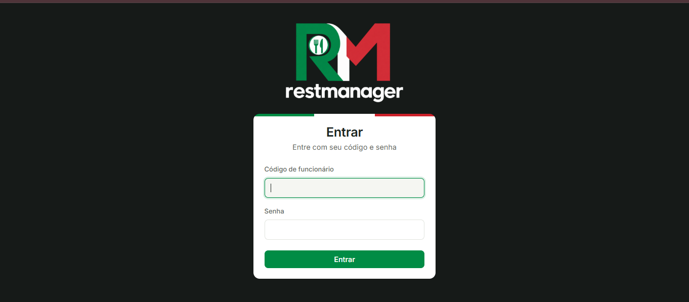

### Funcionários (E1)

Usada pelo administrador para cadastrar, editar, desativar e reativar os funcionários, com código, nome, perfil, telefone e situação. Desativar um funcionário bloqueia o acesso dele na hora, mas mantém o histórico de pedidos e pagamentos.

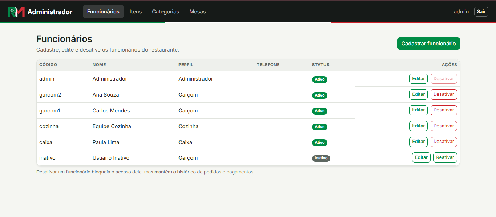

### Itens do cardápio (E2)

Usada pelo administrador para manter o cardápio: cada item tem nome, categoria, preço e situação. Um item desativado sai do cardápio do garçom, sem apagar os pedidos antigos que o usaram.

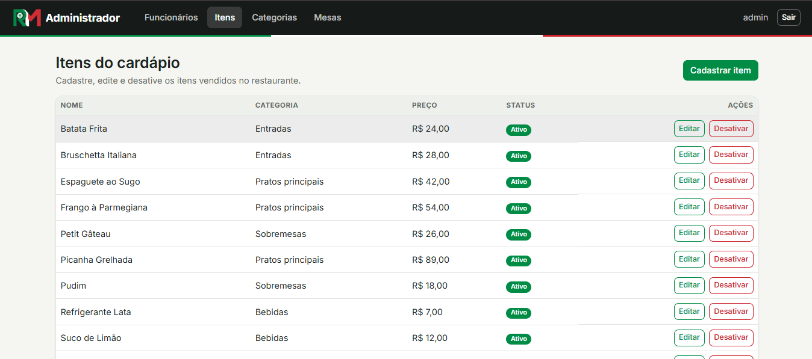

### Categorias do cardápio (E2)

Usada pelo administrador para criar, renomear, ordenar e desativar as categorias (Entradas, Pratos principais, Sobremesas, Bebidas...). A ordem define a sequência em que aparecem para o garçom, e uma categoria com itens ativos não pode ser desativada.

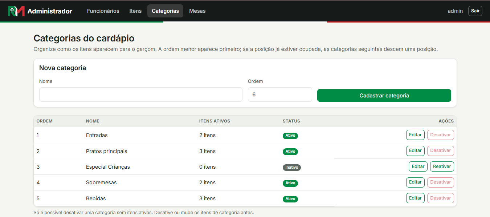

### Mesas (E2)

Usada pelo administrador para cadastrar, editar e excluir as mesas, com número, capacidade e a situação atual de cada uma. Só é possível excluir uma mesa livre, e o histórico de pedidos da mesa é mantido.

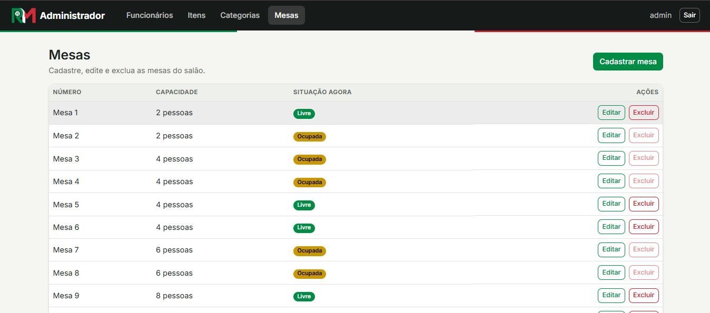

### Área do garçom (E2, E3)

Tela inicial do garçom: mostra o mapa de mesas com a situação de cada uma, atualizado em tempo real, e o cardápio ativo. A partir de uma mesa, o garçom abre o lançamento de pedido; uma mesa em pagamento aparece bloqueada.

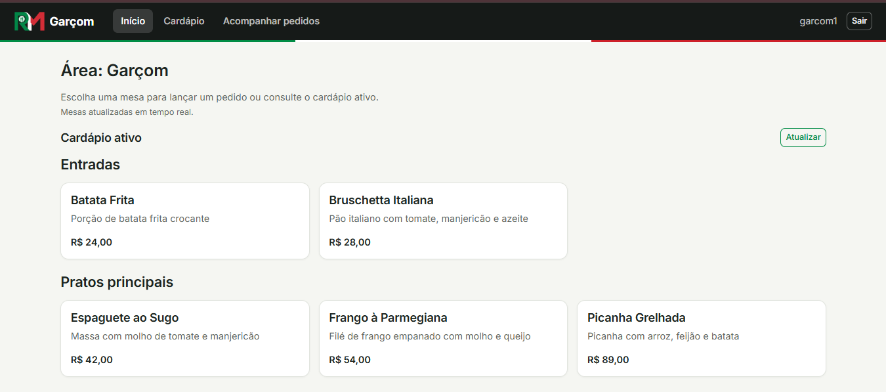

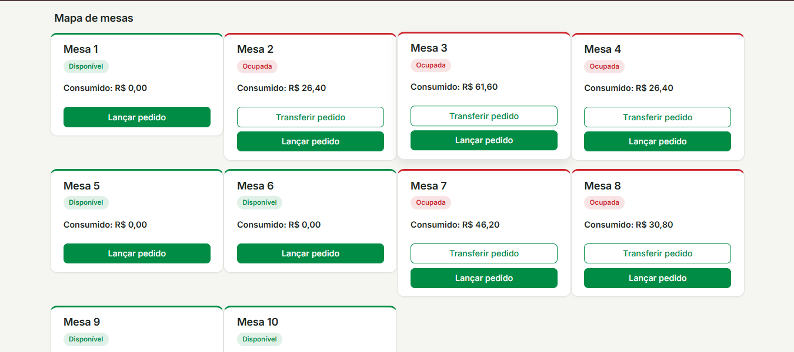

### Lançar pedido (E3)

Usada pelo garçom para registrar o pedido de uma mesa: ele escolhe os itens do cardápio, a quantidade e a observação de cada um (por exemplo, "sem cebola") e vê o subtotal antes de enviar. Ao enviar, o pedido fica gravado para a mesa e aparece na cozinha na mesma hora.

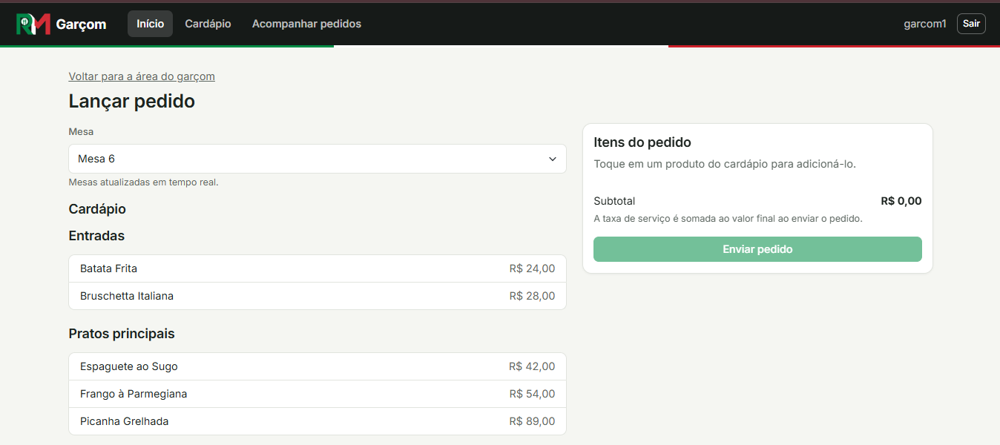

### Acompanhar pedidos (E5)

Usada pelo garçom para acompanhar seus pedidos em aberto: o status de cada item (aguardando, em preparo, pronto) muda sozinho quando a cozinha atualiza, e um aviso aparece quando um item fica pronto para servir. Itens que a cozinha ainda não começou podem ser cancelados por aqui.

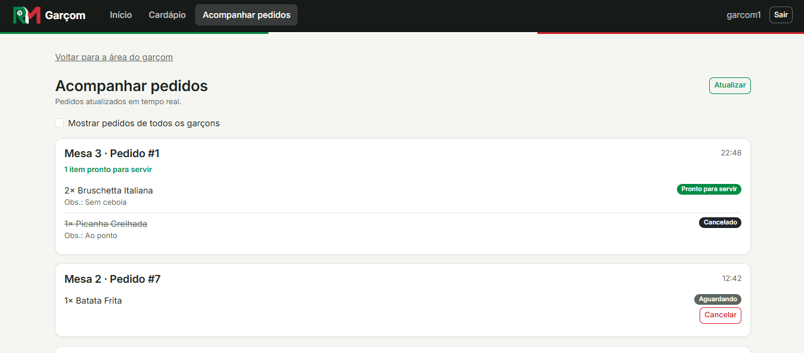

### Painel da cozinha (E4, E5)

Os pedidos novos aparecem automaticamente, sem atualizar a página, na ordem de chegada, com mesa, itens e observações. A cozinha marca cada item como "em preparo" e depois "pronto", e o tempo de espera de cada pedido fica destacado em amarelo a partir de 15 minutos e em vermelho a partir de 30.

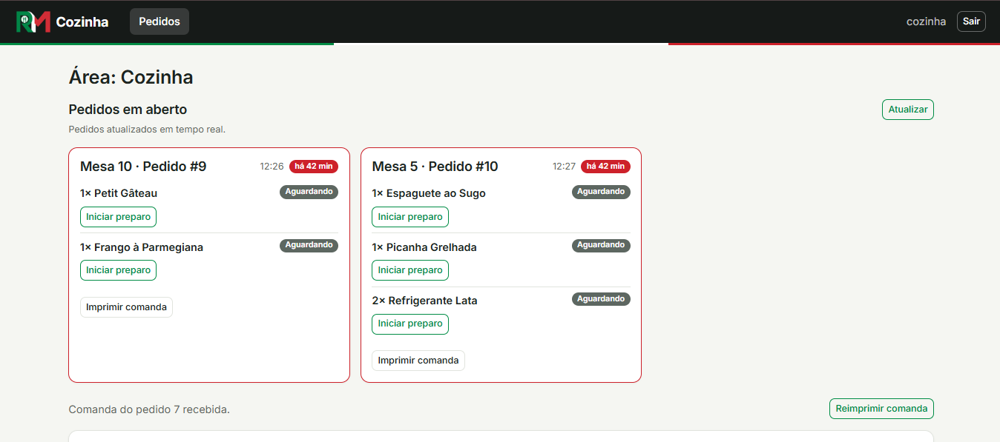

### Mapa de mesas do caixa (E6)

Tela inicial do caixa: mostra todas as mesas com a situação (livre, ocupada, reservada ou em pagamento) e o valor consumido em cada uma, com busca por número e filtro por situação. Daqui o caixa abre o fechamento da conta e acessa o turno, as movimentações, os relatórios e as comandas.

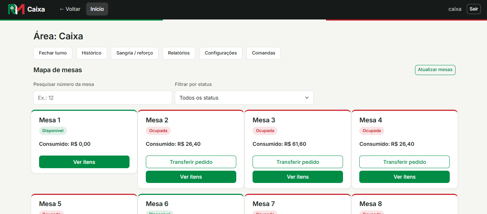

### Fechamento da conta (E7, E8, E9)

Usada pelo caixa para fechar a conta de uma mesa: mostra os pedidos e itens em aberto, o subtotal, a taxa de serviço e o desconto, e permite dividir o valor entre várias formas de pagamento (dinheiro, crédito, débito, Pix e vale-alimentação). O sistema só fecha a conta quando a soma cobre o total. Na mesma tela o caixa pode transferir um pedido em aberto para outra mesa e, depois de pago, baixar o comprovante.

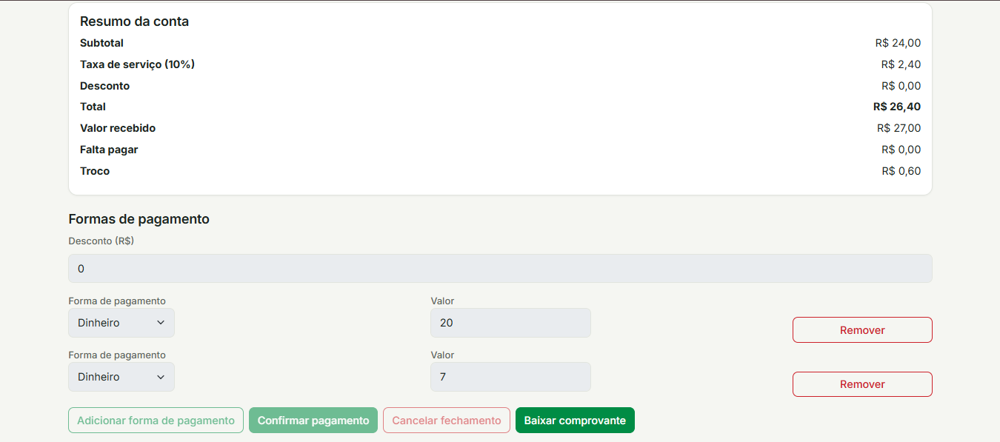

### Comprovante em PDF (E8)

Documento gerado pelo sistema ao fechar a conta, aberto pelo caixa, ao clicar em "Baixar comprovante", para baixar ou imprimir. Traz os itens consumidos, os valores e as formas de pagamento usadas.

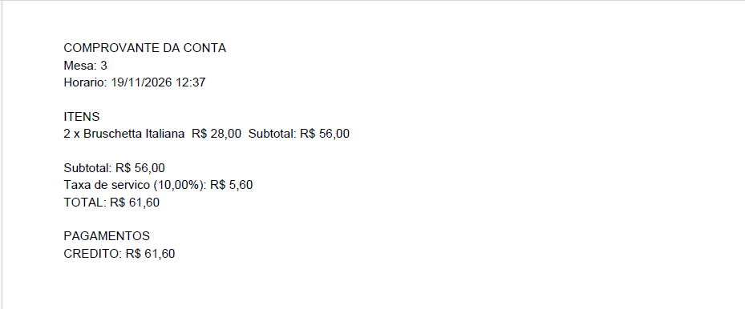

### Fechamento de turno (E6)

Usada pelo caixa ao fim do turno: mostra o valor de abertura, o total recebido por forma de pagamento e a quantidade de pagamentos, e pede o valor contado no caixa para conferência. O turno só fecha se não houver mesa ocupada ou em pagamento, e a comanda de fechamento pode ser reimpressa pelo histórico.

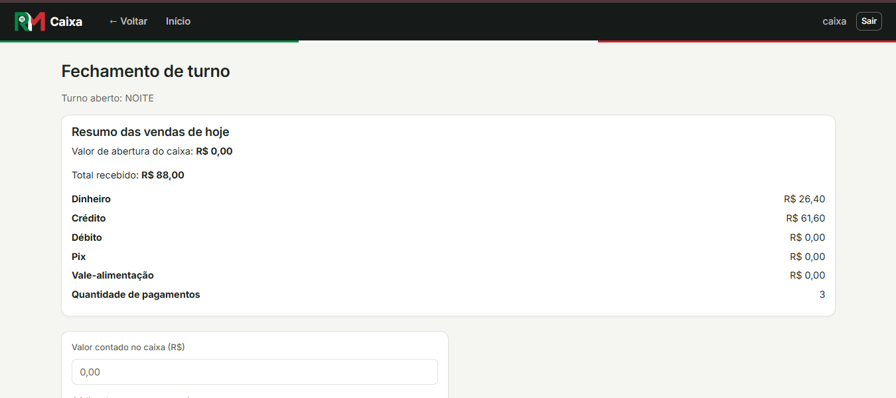

### Sangria e reforço (E10)

Usada pelo caixa para registrar retiradas (sangria) e entradas (reforço) de dinheiro no caixa durante o turno, informando tipo, valor e motivo. Cada movimentação fica listada com data e hora, e a comanda pode ser impressa.

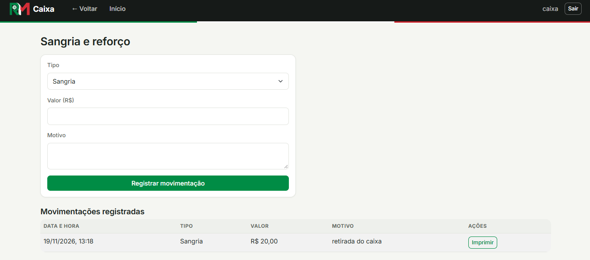

### Relatório diário (E11)

Mostra, para a data escolhida, o total recebido por forma de pagamento e as movimentações de sangria e reforço do dia.

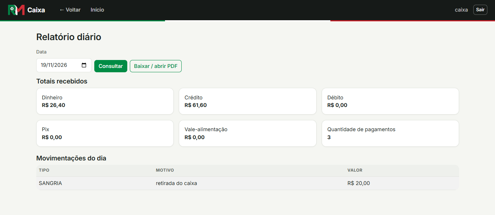

# 9. COMO RODAR

# 10. CONCLUSÃO

# 11. ANEXOS